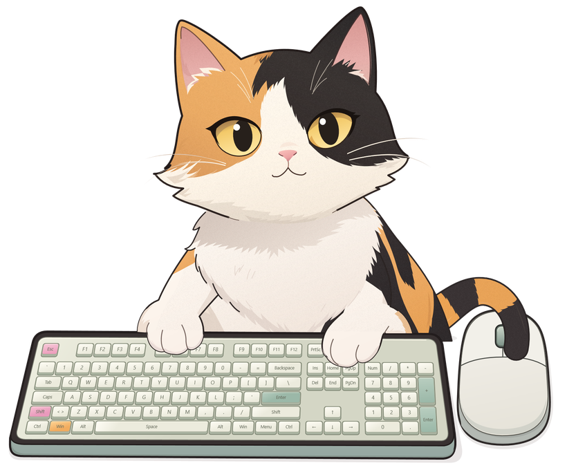

# 爪印小屋 · pawtrail-desktop

[HTML 项目介绍](index.html) 包含桌宠动作预览、使用说明和下载入口。将仓库下载到本地后，双击 `index.html` 即可浏览。



把 [PawTrail-Setup-1.0.2.msi](PawTrail-Setup-1.0.2.msi) 发给朋友，双击即可打开中文安装向导。适用于带有 .NET Framework 4.8 或更高版本的 Windows 10 / 11。

安装时可以更改目录。默认安装到当前用户的 `%LOCALAPPDATA%\Programs\PawTrail`，创建桌面快捷方式；「登录 Windows 时自动启动桌宠」默认关闭。勾选后，下次登录时猫咪会直接出现在桌面。手动从开始菜单或桌面打开，会同时显示工作室。

再次打开安装包，选择「更改」可以调整快捷方式和自启动。也可以在 Windows 的已安装应用列表里卸载「爪印小屋」。卸载后会保留皮肤和位置等个人设置。

启动后，长毛三花猫会坐在键盘后，两只白爪搭在键盘上沿，尾尖搭在鼠标上。

- 两只前爪按键位分工。敲下一个键，对应的爪子就会按向那个键帽，并弹出大号键名。按住组合键时，各键帽同时高亮，两只爪子能同时落键。
- 尾巴专门操作鼠标。移动鼠标时尾尖跟着推，按下左键、右键或中键时尾尖压向对应位置，滚动时则拨动滚轮。边按键边使用鼠标时，两种动作可以同时进行。
- 将指针移到猫的小键盘旁，它会把爪子搭过去。按住猫头，它会舒服地眯起眼。按住后拖动仍可移动桌宠。
- 连续 3 分钟没有键鼠操作，它会趴下打盹。再次打字或动动鼠标就能唤醒。在工作室中也可以点选互动预览，直接看看这四种动作。
- 在工作室的「鼠标位置」中选「左侧」或「右侧」，尾巴会随鼠标换边，两只前爪继续按相同的物理键位分工。初次启动时鼠标在右侧。
- 按住猫咪拖动，可以把它摆到合适的位置。在工作室中可以切换「暖阳三花」「海盐水手」「草莓围巾」，调整桌宠大小，或暂停键鼠同步。
- 关闭工作室后，桌宠会继续陪伴。双击桌宠或通知区域的像素三花猫图标可重新打开工作室。右键菜单里可以退出应用。

皮肤、大小、鼠标侧别、桌宠位置和同步开关保存在 `%LOCALAPPDATA%\PawTrail\settings.ini`。键鼠事件仅用于即时动画。

## 从源码构建

在项目目录打开 Windows PowerShell，运行以下命令，生成同目录的 `PawTrail.exe`。

```powershell
powershell -NoProfile -ExecutionPolicy Bypass -File .\build.ps1
```

构建安装包需要 WiX Toolset 3.14.1。将 `-WixBin` 指向包含 `candle.exe` 和 `light.exe` 的目录。脚本从源码编译桌宠，在项目目录生成单个 MSI 文件。

```powershell
powershell -NoProfile -ExecutionPolicy Bypass -File .\build-installer.ps1 -WixBin "C:\Tools\WiX"
```
